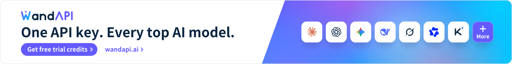
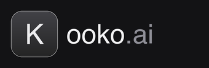
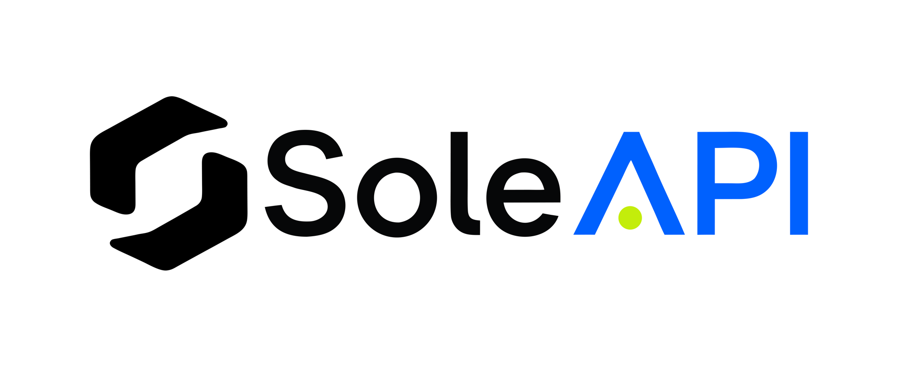

# Sub2API Orange 部署指南

Sub2API Orange 是一个可自托管的 AI API 网关。本 README 只说明部署、升级、备份和迁移。

## 推荐方式：Docker Compose

Docker 部署会运行三个服务：

```text
sub2api -> PostgreSQL
         -> Redis
<a href="https://trendshift.io/repositories/21823" target="_blank"></a>

**AI API Gateway Platform for Subscription Quota Distribution**

English | [中文](README_CN.md) | [日本語](README_JA.md)

</div>

## ⚠️ Important Notice

Please read the following carefully before using this project:

- **🚨 Terms of Service Risk**: Using this project may violate the terms of service of Anthropic and other upstream providers. Please review the relevant providers' user agreements before use; all risks arising from such use are borne solely by the user.
- **⚖️ Compliant Use**: Use this project only in compliance with the laws and regulations of your country or region. Any unlawful use is strictly prohibited.
- **📖 Disclaimer**: This project is provided for technical learning and research purposes only. The authors assume no liability for account bans, service interruptions, data loss, or any other direct or indirect damages resulting from the use of this project.
- **🚫 No Commercial Authorization**: The developers of this project have never authorized any individual or organization to conduct any form of commercial operation based on this project. Any commercial activity conducted in the name of or based on this project is unrelated to this project and its developers, and all resulting disputes, losses, and legal liabilities shall be borne solely by the party conducting such activity.

## ❤️ Sponsors

> [Want to appear here?](mailto:support@sub2api.org)

<details open>
<summary>Click to collapse</summary>

<p align="center"><a href="https://wandapi.ai/r/sub2api"><picture><source media="(prefers-color-scheme: dark)" srcset="assets/partners/banners/wandapi-en-dark.svg"></picture></a></p>

**[WandAPI](https://wandapi.ai/r/sub2api)** — an enterprise-grade, stable AI model API gateway built by a core contributor to this project. One API key gives you access to Claude, GPT, Gemini and other leading models, natively compatible with the OpenAI and Anthropic protocols, so Claude Code, Codex and your existing SDKs work by simply changing the Base URL. Real-time routing by latency and upstream health with millisecond-level automatic failover keeps requests online, backed by 99.99% service availability. Pay as you go, with per-request token and cost breakdowns.

**Free trial credits**: sign up via [this exclusive link](https://wandapi.ai/r/sub2api) to claim free trial credits.

---

<table>

<tr>
<td width="180"><a href="https://cctk.ai/register?aff=SUB2API"></a></td>
<td>Thanks to CCTK.AI for sponsoring this project! <a href="https://cctk.ai/register?aff=SUB2API">CCTK.AI</a> is an AI API gateway focused on stability and cost-effectiveness, offering fast relay services for Claude, OpenAI, Gemini, and other popular models. It works seamlessly with Claude Code, Codex, and other mainstream coding tools, delivering the same model capabilities at a fraction of the official cost. Register via <a href="https://cctk.ai/register?aff=SUB2API">this link</a> for faster, more stable, and more affordable AI API access.</td>
</tr>

<tr>
<td width="180"><a href="https://www.openmodel.ai?ref=sub2api"></a></td>
<td>One API, every top model! <a href="https://www.openmodel.ai?ref=sub2api">OpenModel</a> is a production-grade, high-availability AI API gateway that makes your applications truly fast and stable: automatic failover, smart routing to the best-performing channel, and a production-grade SLA. An SLA that far surpasses any single provider — making stability your core competitive advantage. Works directly with Claude Code, Codex, and Gemini CLI. Register via this link to get started.</td>
</tr>

<tr>
<td width="180"><a href="https://etok.ai"></a></td>
<td>Thanks to ETok.ai for sponsoring this project! ETok.ai is dedicated to building a one-stop AI programming tool service platform. We offer professional Claude Code packages and technical community services, with support for Google Gemini and OpenAI Codex. Through carefully designed plans and a professional tech community, we provide developers with reliable service guarantees and continuous technical support, making AI-assisted programming a true productivity tool. Click <a href="https://etok.ai">here</a> to register!</td>
</tr>

<tr>
<td width="180"><a href="https://apikey.fan/register?aff=SUB2API"></a></td>
<td>Thanks to APIKEY.FUN for sponsoring this project! <a href="https://apikey.fan/register?aff=SUB2API">APIKEY.FUN</a> is one of the core contributors to the sub2api open-source project, dedicated to providing open, stable, and cost-effective AI API access. The platform supports API relay services for Claude, OpenAI, Gemini, and other popular models, with pricing starting from as low as 7% of the original rate. Register via the exclusive link: <a href="https://apikey.fan/register?aff=SUB2API">APIKEY</a> to enjoy up to 5% off on all recharges.</td>
</tr>

<tr>
<td width="180"><a href="https://api.aigocode.dev/invite/SUB2API"></a></td>
<td>Thanks to AIGoCode for sponsoring this project! AIGoCode is an all-in-one platform that integrates Claude Code, Codex, and the latest Gemini models, providing you with stable, efficient, and highly cost-effective AI coding services. The platform offers flexible subscription plans, zero risk of account suspension, direct access with no VPN required, and lightning-fast responses. AIGoCode has prepared a special benefit for sub2api users: if you register via <a href="https://api.aigocode.dev/invite/SUB2API">this link</a>, you'll receive an extra 10% bonus credit on your first top-up!</td>
</tr>

<tr>
<td width="180"><a href="https://codex-everywhere.com"></a></td>
<td>Real GPT-5.6 series at 3% of OpenAI pricing — <a href="https://codex-everywhere.com">CodexEverywhere</a> is democratizing access to frontier models for developers worldwide. We believe in transparency and honesty, with model quality verified by active community oversight for months. USD and crypto friendly. Start with a free $20 trial at <a href="https://codex-everywhere.com">codex-everywhere.com</a>.</td>
</tr>

<tr>
<td width="180"><a href="https://bestproxy.com/?keyword=a2e8iuol"></a></td>
<td>Thanks to Bestproxy for sponsoring this project! <a href="https://bestproxy.com/?keyword=a2e8iuol">Bestproxy</a> provides high-purity residential IPs with dedicated one-IP-per-account support. By combining real home networks with fingerprint isolation, it enables link environment isolation and reduces the probability of association-based risk control.</td>
</tr>

<tr>
<td width="180"><a href="https://pateway.ai/?ch=1tsfr51"></a></td>
<td>Thanks to PatewayAI for sponsoring this project! <a href="https://pateway.ai/?ch=1tsfr51">PatewayAI</a> is a premium API relay built for heavy AI developers, offering the full Claude and Codex series sourced 100% from official providers, with transparent token-level billing. Enterprise plans include high concurrency, dedicated management, contracts, and invoicing. Register now to get $3 in trial credits, top-ups from 60% off, and referral bonuses up to $150.</td>
</tr>

<tr>
<td width="180"><a href="https://api.pptoken.cc/register?promo=SUB2API"></a></td>
<td>Thanks to PPToken.cc for sponsoring this project! <a href="https://api.pptoken.cc/register?promo=SUB2API">PPToken.cc</a> specializes in GPT model API relay services, supporting Codex, Claude Code, OpenAI-compatible clients, and Gemini CLI integration. Top-ups are 1:1 (¥1 = $1 credit); GPT models start at 0.16x rate multiplier, with overall cost at roughly 2.2% of official pricing and first-token latency around 1 second — ideal for developers seeking low-cost, high-speed access to GPT model capabilities. Technical support: 24/7 real human responses (no bots), @tech in the group chat and get a reply within 10 minutes. Sponsor benefit: the first 200 users who register via the <a href="https://api.pptoken.cc/register?promo=SUB2API">exclusive registration link</a> and enter promo code `SUB2API` can claim free Codex / Claude Code trial credits — no minimum spend, no card required.
</td>
</tr>

<tr>
<td width="180"><a href="https://veilx.io/#/hello/SJRBRVDV"></a></td>
<td>Thanks to Veilx for sponsoring this project! <a href="https://veilx.io/#/hello/SJRBRVDV">Veilx</a> CDN is purpose-built for large-scale AI API traffic, deeply optimized for relay services and call chains across OpenAI, Claude, Gemini, and scenarios like chat, image generation, embeddings, and streaming — delivering lower latency and higher stability under heavy concurrency. It also offers China three-network optimized return lines, making it ideal for global AI relay platforms, overseas AI SaaS, and cross-border high-concurrency deployments.
</td>
</tr>

<tr>
<td width="180"><a href="https://roxybrowser.com/invite/bgGKG7"></a></td>
<td>Thanks to RoxyBrowser for sponsoring this project! <a href="https://roxybrowser.com/invite/bgGKG7">RoxyBrowser</a> RoxyBrowser is the perfect partner for Sub2API: it features a built-in native Roxy AI Agent and high-quality native residential IPs, supports batch automation via simple commands, and significantly boosts security and efficiency for multi-account management! Click <a href="https://roxybrowser.com/invite/bgGKG7">this link</a> to sign up and receive a free residential IP package plus a 10% lifetime discount.
</td>
</tr>

<tr>
<td width="180"><a href="https://nagora.ai/"></a></td>
<td><a href="https://nagora.ai/">Nagora</a> is a multi-model AI API gateway built for developers and teams. With a single account and API key, you can access more than 26 leading text and image models through one unified interface. It is compatible with OpenAI, Anthropic, and Gemini protocols and integrates seamlessly with development tools such as Claude Code, Codex, and Gemini CLI. The platform provides intelligent routing, automatic failover, transparent pricing, and consolidated billing, along with budget management, rate limiting, and concurrency controls. This makes AI usage more reliable and manageable across individual development, team collaboration, and production environments. No changes to your existing application are required. Simply replace the Base URL and API key to complete the integration in as little as one minute.</td>
</tr>

<tr>
<td width="180"><a href="https://s.qiniu.com/u6rQrq"></a></td>
<td>Thanks to Qiniu AI for sponsoring this project! Qiniu AI is the enterprise-grade large-model MaaS platform under Qiniu Cloud (02567.HK), offering one-stop access to 150+ mainstream models worldwide, compatible with the protocols of major global model providers, and covering full-modality capabilities including text, image, audio, video, and file processing, serving over 1.69 million enterprises and developers. Qiniu AI offers an exclusive benefit for Sub2API users: register via <a href="https://s.qiniu.com/u6rQrq">this link</a> — enterprise users get 12 million tokens free, and developers get 3 million tokens free.</td>
</tr>

<tr>
<td width="180"><a href="https://api.fenno.ai/s/dC4k"></a></td>
<td>Thanks to FennoAI for sponsoring this project! FennoAI is a high-stability, high-performance API relay provider for enterprise R&D teams and developers, compatible with the OpenAI and Anthropic protocols and seamlessly integrating with mainstream AI coding tools such as Codex, Claude Code, and OpenCode. The platform delivers enterprise-grade stability, supporting call volumes of 100 billion tokens per day, and supports business-to-business settlement and invoicing for both domestic and overseas entities to meet enterprise R&D and procurement needs. As an exclusive benefit for Sub2API users, purchase a subscription via the <a href="https://api.fenno.ai/s/dC4k">exclusive link</a> to get $50 worth of Coding Plan credit for only $1.99. Referral rewards are also available: invite friends to purchase and earn up to 20% commission — the more you invite, the more you earn.</td>
</tr>

<tr>
<td width="180"><a href="https://lanox.ai/?c=6"></a></td>
<td>Thank you to LanoX AI for sponsoring this project! <a href="https://lanox.ai/?c=6">LanoX AI</a> provides stable, cost-effective global model access services for developers, teams, and enterprises. 🎁 New User Benefits — Claim millions of free tokens, plus 500+ free models for easier low-cost testing, validation, and deployment 🧠 Global Leading Models — GPT · Claude · Gemini · Qwen · Grok... 🎬 Multimodal Creation — Seedance 2.0 · GPT Image · Gemini Nano Banana 🛡️ Enterprise-Grade Reliability — High availability 💎 native capability output 💎 no intelligence degradation 💎 no model mixing 💎 transparent usage and billing 💎 💰 Lower API Costs — Top-tier models from as low as 10% of official pricing, with clear documentation, simple integration, invoicing support, and enterprise-scale batch usage 🏢 Enterprise Choice — Ideal for AI products, Agents, content platforms, and R&D teams with high-volume model usage</td>
</tr>

<tr>
<td width="180"><a href="https://www.rapidproxy.io/?ref=sub2api"></a></td>
<td><a href="https://www.rapidproxy.io/?ref=sub2api">RapidProxy</a> is a data collection proxy solution built for developers, providing stable and reliable residential proxy services. With 90M+ global residential IPs and 200+ country coverage, intelligent rotation, and precise geo-targeting, it helps projects such as web scraping, AI data training, SEO monitoring, and e-commerce data analysis break through access restrictions and improve data collection efficiency. It supports mainstream automation frameworks such as Playwright, Selenium, and Puppeteer, with prices as low as $0.65/GB — <a href="https://www.rapidproxy.io/?ref=sub2api">start your free test now</a>.</td>
</tr>

<tr>
<td width="180"><a href="https://hao.ai"></a></td>
<td><a href="https://hao.ai">hao.ai</a> is a high-speed, stable unified large-model API gateway for developers and teams. With a single API Key and a unified interface, you can access mainstream models such as GPT, Claude, and xAI Grok, with compatibility for common protocols and SDKs including OpenAI and Anthropic. The platform provides model routing, failover, team management, and complete request logs, with model prices as low as 15% of official reference pricing, helping users build AI applications more simply, more reliably, and at lower cost.</td>
</tr>

<tr>
<td width="180"><a href="https://www.swiftproxy.net/?ref=sub2api"></a></td>
<td>Swiftproxy is a high-performance proxy solution built for developers, providing stable and reliable residential and static residential proxy services. With 90M+ clean residential IPs, global coverage, flexible rotation, and precise geo-targeting, it helps projects such as web scraping, AI automation, browser automation, SEO monitoring, and multi-account management overcome access restrictions and improve workflow efficiency. It supports HTTP(S) and SOCKS5 protocols, integrates with popular automation tools like Playwright, Selenium, and Puppeteer, with dynamic proxy traffic that never expires until used and free testing available — <a href="https://www.swiftproxy.net/?ref=sub2api">start your free test now</a>!</td>
</tr>

<tr>
<td width="180"><a href="https://go.apimart.ai/gh-sub2api"></a></td>
<td>Thanks to APIMart for sponsoring this project! <a href="https://go.apimart.ai/gh-sub2api">APIMart</a> is a low-cost API platform for AI image and video generation — GPT-Image-2 from $0.006 per image, with 160+ images per dollar. One async API covers both image and video: submit a task, get an ID, and retrieve results via polling or callback. Batch tens of thousands of images without timeouts, and switch models without changing code. Pay as you go with no monthly fee — <a href="https://go.apimart.ai/gh-sub2api">sign up here</a> to get started.</td>
</tr>

<tr>
<td width="180"><a href="https://www.axisnow.io/"></a></td>
<td>Thanks to AxisNow for sponsoring this project! <a href="https://www.axisnow.io/">AxisNow</a> protects and accelerates websites and APIs, delivering an optimal access experience across mainland China and globally, while extending acceleration and security capabilities to native/mobile apps through client SDKs — <strong>self-hosted private-deployment CDN</strong> | <strong>subscription-based DDoS-protected CDN</strong> | <strong>autonomous, flexibly composable CDN network</strong>.</td>
</tr>

<tr>
<td width="180"><a href="https://pp.dog/register?aff=SUB2API"></a></td>
<td><a href="https://pp.dog/register?aff=SUB2API">PP.dog</a> is a source-level API gateway with its own massive account pool, purpose-built as an upstream relay for downstream transit stations and high-frequency developers — saving you the hassle of building and maintaining your own account pool. ✅ Direct from source: self-operated account pool with no middleman markup; 🧧 Cost crusher: combined rate multiplier as low as 0.03x, just 0.35% of official pricing; 🚀 Blazing fast: first-token latency < 1s, on par with the official native API. <a href="https://www.pp.dog/register?aff=SUB2API">Get started with PP.dog now</a></td>
</tr>

<tr>
<td width="180"><a href="https://colaproxy.com/?utm_source=sub2api&utm_medium=sub2api&ref=sub2api"></a></td>
<td>ColaProxy provides high-quality residential proxies built for web scraping, automation, and multi-account management. Get a free trial with non-expiring traffic, pricing starting as low as $0.3/GB, unlimited concurrent connections, and intelligent IP rotation for a smoother, more stable proxy experience. Use discount code COLA10 to get 10% off and start scaling your projects with reliable residential proxies today. <a href="https://colaproxy.com/?utm_source=sub2api&utm_medium=sub2api&ref=sub2api">Get started with ColaProxy</a></td>
</tr>

<tr>
<td width="180"><a href="https://modelflare.dev/sign-up?utm_source=github&utm_campaign=sub2api"></a></td>
<td>Modelflare: Full strength, stable, nothing watered down. Global SOTA models at a lower cost. Operated by US-based Havenbyte LLC, Modelflare supports GPT, Claude, Gemini, Grok, and other leading models through common compatible protocols, plus 40+ image and video models. Cache compensation is a highlight: selected OpenAI groups (price-first, stable, and premium) guarantee daily cache hit rates of 65%, 75%, or 85%, and if eligible requests fall short, Modelflare refunds the difference, visible on the usage dashboard after settlement. Special offers: a single top-up of US$20 unlocks the GPT discount group at a 0.015x price multiplier, and a single top-up of US$50 unlocks the Claude discount group at a 0.03x multiplier. Register via <a href="https://modelflare.dev/sign-up?utm_source=github&utm_campaign=sub2api">this exclusive link</a> to get started.</td>
</tr>

<tr>
<td width="180"><a href="https://x.com/chenju_ai"></a></td>
<td>Thanks to <a href="https://x.com/chenju_ai">Chenju</a> for sponsoring this project! This is probably the only ad slot in this section that doesn't ask you to sign up for anything. Good open-source projects deserve to be paid for, so Chenju is chipping in a gift and raising a glass to the author. Find <a href="https://x.com/chenju_ai">Chenju</a> on X to chat about API relays, upstream providers, or just shoot the breeze.</td>
</tr>

<tr>
<td width="180"><a href="https://t.me/AACC8888888"></a></td>
<td>🔑 Buying AI accounts at top prices | Gemini · Claude · GPT | Main and alt accounts all welcome, any channel wanted | Pay-per-usage supported | Seeking first-hand resources from major providers, I'll bring the KEY.<br>WeChat: Liuyou-zawd | Telegram: <a href="https://t.me/AACC8888888">AACC8888888</a></td>
</tr>

<tr>
<td width="180"><a href="https://niuproxy.com/?utm_source=sub2api&utm_medium=sub2api&ref=sub2api"></a></td>
<td><a href="https://niuproxy.com/?utm_source=sub2api&utm_medium=sub2api&ref=sub2api">NiuProxy</a> provides affordable global proxy solutions for web scraping, AI agents, automation, and data collection. With residential proxies starting at $0.35/GB across 190+ countries and regions, NiuProxy offers flexible plans and HTTP(S)/SOCKS5 support.<br>🎁 Use code PAY2 for 10% OFF your recharge!</td>
</tr>

<tr>
<td width="180"><a href="https://soleapi.com/r/sub2api"></a></td>
<td>Thanks to <a href="https://soleapi.com/r/sub2api">SoleAPI</a> for supporting this project! SoleAPI is an AI model gateway for developers and enterprises: one API key gives you access to 30+ leading models including Claude, GPT and Gemini. It is natively compatible with the OpenAI and Anthropic protocols, so Claude Code, Codex, Cursor and your existing SDKs work by simply changing the Base URL. Requests are routed in real time by latency and upstream health, with millisecond-level automatic failover to backup channels, 99.99% service availability and 24/7 technical support. Every call lands on a single bill with per-request token and cost breakdowns you can inspect at any time. Sign up through this project's <a href="https://soleapi.com/r/sub2api">referral link</a> to receive free trial credits, and earn ongoing cashback by inviting friends who top up!</td>
</tr>

</table>

</details>

## Overview

Sub2API is an AI API gateway platform designed to distribute and manage API quotas from AI product subscriptions. Users can access upstream AI services through platform-generated API Keys, while the platform handles authentication, billing, load balancing, and request forwarding.

## Features

- **Multi-Account Management** - Support multiple upstream account types (OAuth, API Key)
- **API Key Distribution** - Generate and manage API Keys for users
- **Precise Billing** - Token-level usage tracking and cost calculation
- **Smart Scheduling** - Intelligent account selection with sticky sessions
- **Concurrency Control** - Per-user and per-account concurrency limits
- **Rate Limiting** - Configurable request and token rate limits
- **Built-in Payment System** - Supports EasyPay, Alipay, WeChat Pay, and Stripe for user self-service top-up, no separate payment service needed ([Configuration Guide](docs/PAYMENT.md))
- **Admin Dashboard** - Web interface for monitoring and management
- **Composite Groups** - Admin routing layer that resolves requested models to concrete providers for multi-provider groups ([Operator Guide](docs/COMPOSITE_GROUPS.md))
- **External System Integration** - Embed external systems (e.g. ticketing) via iframe to extend the admin dashboard

## Ecosystem

Community projects that extend or integrate with Sub2API:

| Project | Description | Features |
|---------|-------------|----------|
| ~~[Sub2ApiPay](https://github.com/touwaeriol/sub2apipay)~~ | ~~Self-service payment system~~ | **Now Built-in** — Payment is now integrated into Sub2API, no separate deployment needed. See [Payment Configuration Guide](docs/PAYMENT.md) |
| [sub2api-mobile](https://github.com/ckken/sub2api-mobile) | Mobile admin console | Cross-platform app (iOS/Android/Web) for user management, account management, monitoring dashboard, and multi-backend switching; built with Expo + React Native |

## Tech Stack

| Component | Technology |
|-----------|------------|
| Backend | Go 1.27.0, Gin, Ent |
| Frontend | Vue 3.4+, Vite 5+, TailwindCSS |
| Database | PostgreSQL 15+ |
| Cache/Queue | Redis 7+ |

---

## Nginx Reverse Proxy Note

When using Nginx as a reverse proxy for Sub2API (or CRS) with Codex CLI, add the following to the `http` block in your Nginx configuration:

```nginx
underscores_in_headers on;
```

默认镜像：

```text
ghcr.io/juziool/sub2api-orange:latest
```

### 全新安装

要求：Docker Engine、Docker Compose v2、Linux amd64/arm64。

```bash
mkdir -p /opt/sub2api-orange
cd /opt/sub2api-orange
curl -fsSL https://raw.githubusercontent.com/JuZiool/sub2api-orange/main/deploy/to-install.sh \
  | bash
```

不带参数且在交互终端执行时会进入菜单：

```text
1) 全新安装
2) 迁移安装
3) 更新镜像
4) 创建备份
5) 健康检查
6) 回滚镜像
```

选择 **1：全新安装** 后，脚本会询问服务端口、管理员邮箱和管理员初始密码。选择其他操作时使用已有 `.env` 和数据，不会重新生成密钥。

自动化或明确指定模式时，可使用：

```bash
curl -fsSL https://raw.githubusercontent.com/JuZiool/sub2api-orange/main/deploy/to-install.sh \
  | bash -s -- --mode 1
```

脚本会：

- 下载 Compose 配置和 GHCR 镜像 overlay；
- 生成数据库、Redis、JWT、TOTP 密钥；
- 创建 `.env`、`data/`、`postgres_data/`、`redis_data/`；
- 启动 PostgreSQL、Redis 和 Sub2API；
- 等待容器健康状态和 `/health` 通过。

首次安装不会在终端打印完整密钥。请妥善保存部署目录中的 `.env`。

管理员邮箱或密码留空时，将在首次启动时随机生成，不再使用固定默认管理员邮箱。显式设置的密码必须为 8–72 字节。仅在本机查看首次启动日志中的凭据，不要公开分享：

```bash
docker compose --env-file .env -f docker-compose.local.yml -f docker-compose.ghcr.yml logs sub2api | grep "Generated admin"
```

### 已有部署迁移

将以下内容从旧服务器复制到新服务器：

```text
.env
data/
postgres_data/
redis_data/
```

然后在部署目录执行：

```bash
bash to-install.sh --mode 2
```

迁移模式不会重新生成密钥，不会删除 Docker volume，也不会覆盖已有配置。跨 PostgreSQL 大版本迁移时，优先使用逻辑备份，不要直接复制正在运行中的数据库目录。

### 日常更新

```bash
bash to-install.sh update
```

更新流程默认会：

1. 创建基础备份；
2. 拉取 `ghcr.io/juziool/sub2api-orange:latest`；
3. 只重建 `sub2api` 应用容器；
4. 保持 PostgreSQL 和 Redis 继续运行；
5. 检查三个容器和 `/health`；
6. 失败时恢复上一次应用镜像。

固定版本或 digest：

```bash
bash to-install.sh update \
  --image ghcr.io/juziool/sub2api-orange:0.2.1-4
```

本地已有镜像时可跳过拉取：

```bash
bash to-install.sh update \
  --image ghcr.io/juziool/sub2api-orange:local \
  --no-pull
```

### 备份、健康检查和回滚

```bash
# 创建基础备份
bash to-install.sh backup

# 检查 Compose、容器和 /health
bash to-install.sh health

# 回滚到上一次成功更新前的应用镜像
bash to-install.sh rollback
```

备份目录：

```text
backups/<timestamp>/
├── env
├── data.tar.gz
├── postgres.sql.gz
├── redis-data.tar.gz
├── metadata.txt
└── compose/
```

数据库迁移是向前的。应用镜像回滚不会自动回滚数据库结构；如需恢复数据库，请使用 `postgres.sql.gz` 或其他可靠备份。

## 常用命令

```bash
# 查看状态
to-install.sh health

# 查看应用日志
docker compose --env-file .env \
  -f docker-compose.local.yml \
  -f docker-compose.ghcr.yml \
  logs -f sub2api

# 查看全部容器
docker compose --env-file .env \
  -f docker-compose.local.yml \
  -f docker-compose.ghcr.yml \
  ps

# 健康接口
curl http://127.0.0.1:8080/health
```

默认访问地址：

```text
http://服务器IP:8080
```

生产环境建议使用 Nginx 或 Caddy 提供 HTTPS、域名和管理端访问限制。PostgreSQL `5432` 与 Redis `6379` 默认只在 Compose 内部网络使用，不应暴露到公网。

## 传统二进制/systemd 部署

如果不使用 Docker，可以使用独立的二进制安装器：

```bash
curl -fsSL https://raw.githubusercontent.com/JuZiool/sub2api-orange/main/deploy/install.sh \
  | sudo bash
```

该方式使用：

```text
程序：/opt/sub2api/sub2api
配置：/etc/sub2api/config.yaml
服务：sub2api.service
```

二进制模式的升级、回滚和后台在线更新与 Docker 镜像更新相互独立。Docker 部署请使用 `to-install.sh`，不要在容器内执行二进制替换更新。

## 版本与镜像

Orange 版本基于官方上游版本增加修订号：

```text
上游 0.2.1
Orange 0.2.1-1、0.2.1-2、0.2.1-3、0.2.1-4、...
```

当上游升级到 `0.2.2` 后，Orange 再从 `0.2.2-1` 开始编号。

Release：

- https://github.com/JuZiool/sub2api-orange/releases

GHCR：

```text
ghcr.io/juziool/sub2api-orange
```

## 配置和安全

- `.env` 包含数据库密码和加密密钥，不要提交到 Git 或公开分享；
- `JWT_SECRET` 和 `TOTP_ENCRYPTION_KEY` 必须在迁移、更新和重启过程中保持不变；
- 全新安装不能用于已有数据目录；已有部署使用迁移模式；
- 更新前保留可恢复的 PostgreSQL 备份；
- 生产环境使用固定镜像 tag 或 digest，不要依赖不可追踪的 `latest`；
- 只开放 HTTPS 和必要的管理端口。

详细 Docker 配置见 [`deploy/README.md`](deploy/README.md)，镜像说明见 [`deploy/DOCKER.md`](deploy/DOCKER.md)。
